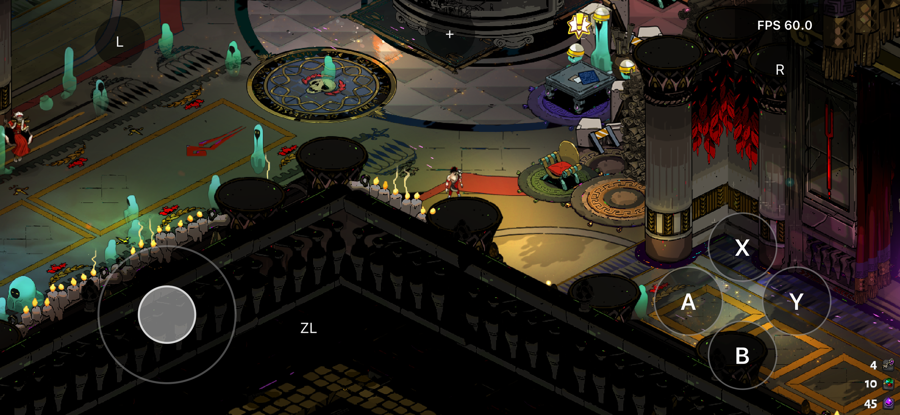

# Hades iOS

用于在 iPhone 上运行你自行准备的 Nintendo Switch 版 **Hades** 的实验性原生
ARM64 兼容层。基于 [D2R Mobile](https://github.com/jhaizhou-ops/d2r-mobile)，
使用独立的 Hades 运行时、UIKit 应用、资源准备与验证流程。

English: [README.md](README.md)



*用户提供的游戏运行截图。图中 FPS 是单次读数，不代表持续性能保证。*

**本项目提供源码和工具，不提供游戏下载，也不是已完成的商业品质移植。**
游戏文件与密钥必须由你自行合法取得。不要上传游戏程序、资源、存档、密钥或
本地构建的安装包。本项目与 Supergiant Games、Nintendo、Apple 无隶属关系。

## 这是什么，不是什么

**是：** 面向 Hades 的平台适配，原生执行游戏 ARM64 程序，提供必要的宿主服务
和 iPhone 触屏界面，图形路线为 **Vulkan → MoltenVK → Metal**。

**不是：** CPU 模拟、云游戏、游戏下载、通用 Switch 兼容层，也不是只改了名字的
D2R 移植。D2R 的专用玩法补丁、云存档、设备覆盖和性能结论不会自动继承。

## 经过实战检验

最新记录的真机检查点是 **第 37 版**，设备为 **iPhone 15 Pro Max（A17 Pro），
iOS 26.7.1**。真机日志和用户反馈确认了以下有限范围的结果。与上游 D2R 的广泛
测试矩阵不同，这里是**单设备证据**，不代表全游戏兼容：

| 范围 | 已验证检查点 |
|---|---|
| 游戏与图形 | 原生进入游戏并显示可玩场景；使用 **Vulkan → MoltenVK → Metal**，不是上游 D2R 的 NVN 渲染路线 |
| 操作 | 模拟触屏摇杆、移动与动作同时输入、圆形动作键全区域命中与按下高亮 |
| 显示 | 已安装 1560×720 的 `wide-720p` 配置；左侧祝福 HUD 内移在测试手机上得到确认 |
| 切换 App | 第 34 版日志记录两次切后台再返回，原场景、声音和操作均正常恢复 |
| 启动 | 第 36 版自动校验资源并进入游戏；首次成功呈现画面后才结束加载 |
| 诊断 | 点击右上角 **FPS**，再点击监控面板内的 **查看／导出本地日志**；未显式导出时日志仅保存在本机 |
| 应用标识 | 第 37 版显示名称为 **Hades**，图标由用户本地游戏文件生成；桌面名称与图标均得到确认 |
| 升级 | 已记录的第 37 版安装前后，12 份状态／存档文件哈希一致 |

完整通关、长时间游玩、全部中断场景及其他设备仍未验证。上游 D2R 的设备列表、
60 帧宣传、iCloud 功能与截图**不适用于 Hades**。

## 极速、流畅、省电

原生执行避免了 CPU 模拟开销，但本项目**尚无经过验证的持续帧率、功耗或续航
测量结果**。上面的图片是用户提供的真实运行截图，不是性能基准。

| 配置或观察 | Hades 状态 |
|---|---|
| 默认渲染尺寸 | 1280×720 |
| 已测试宽屏配置 | 1560×720（`wide-720p`），搭配特定构建的 HUD 覆盖 |
| 1080p | 实验性配置，已在测试手机上回退，不是推荐基线 |
| FPS 显示 | 统计单调时钟窗口内成功的 Vulkan 呈现次数 |
| 前台稳定性检查 | 第 33 版用户反馈连续游玩十分钟；日志达到 34,200 次呈现，未出现先前的回读预算错误 |
| 功耗与温控 | 未发布 Hades 测量数据，不保证续航 |

默认关闭高开销 GPU 像素／通道捕获。该诊断模式会改变时序，并可能达到回读内存
上限，不是正常游玩功能。完整资源归档约 3.9 GB，与应用分开传输；不能套用 D2R
的包体积数字。

## 为手指重新设计

左侧模拟摇杆支持移动和斜向输入，八个动作按钮向游戏发布输入，移动可与动作同时
进行。主要圆形按钮整个命中区域均能响应，并显示按下状态；松开、取消或离开前台
时会清除按住的输入。

右上角 FPS 可展开监控面板，日志入口位于其中，不再在画面底部单独放置按钮。
原生轻触感已实现，但实体震动仍需验证，也不等同于游戏手柄震动协议。

### 手柄

触屏前端向客体发布虚拟手柄输入，并不证明外接蓝牙／USB 手柄兼容，也不继承
D2R 的自动触屏／手柄切换。实体手柄与游戏震动尚不能标为已验证。

## 原版之上的新玩法

本项目的变更是把启动、画面和操作适配到 iPhone，不包含 D2R 的秘境、掉落规则、
仓库系统或其他专用模式。目标是保留 Hades 玩法，而不是重写其规则。

### 直接启动与游戏内诊断

正常启动显示资源校验进度，进入活跃前台后仅启动一次游戏；首次成功呈现画面后才
启用操作。失败会显示诊断信息，不会静默跳过检查。可通过 FPS 监控查看／导出
日志；打开诊断页不会暂停或重启正在运行的游戏。

### 宽屏与 HUD 布局

可选 `wide-720p` 配置调整已验证构建的虚拟画布，使用哈希保护的只读 UI 覆盖。
测试手机的左侧祝福 HUD 已向内移动。这不是通用刘海／安全区适配，独立的暗角
遮罩候选修复仍未确认有效。

### 存储：本地存档与安全升级

`Documents/HadesState` 保存本地离线身份与存档命名空间。宿主使用快照事务及
恢复检查，不代表支持 iCloud，也不保证所有断电场景均安全。保持相同的授权
bundle ID 原位升级可保留容器，但每次升级仍应先备份，再核对文件哈希。

### 日常游玩与 App 切换

协作式暂停／恢复在安全边界暂停客体执行，排空 GPU 工作并暂停音频。返回前台
后恢复画面、音频、输入和客体时钟；已测试的 App 切换能回到同一场景继续。
这不等于后台运行、强制存档或防止 iOS 回收进程；安全转换失败仍保留显式退出
保护。

### 中文与英文

仓库维护对应的中英文文档。游戏可用语言由用户的 Hades 内容决定；D2R 自定义
语言菜单及翻译并不属于本移植。

## 怎么做到的

游戏原始 ARM64 程序通过提前改写适配苹果执行环境。`portable-abi` 改写配置
排除 D2R 专用玩法补丁；原生宿主提供所需的平台服务子集、线程、本地存储、音频
和输入。Vulkan 调用通过固定版本、公开 API 的 MoltenVK 框架转接 Metal；
着色器和资源绑定在本地准备。不使用 CPU JIT、远程串流或 D2R 游戏程序。

| 路径 | 用途 |
|---|---|
| [`hades/ios/`](hades/ios/) | UIKit 启动／加载界面、触控、FPS 监控与诊断 |
| [`hades/runtime/`](hades/runtime/) | 原生宿主、Vulkan 桥接、音频、本地存档和协作式生命周期 |
| [`hades/tools/`](hades/tools/) | 提取、ABI 改写、着色器准备、打包与签名 |
| [`hades/tests/`](hades/tests/) | 合成 ABI、运行时、UIKit、打包与签名回归 |
| [`hades/toolchain.json`](hades/toolchain.json) | 公共工具／框架的固定版本及归档哈希 |
| [`hades/target.json`](hades/target.json) | 接受的游戏标识与兼容性检查点 |
| `dm/` | 保留的上游代码，包含共享改写／嵌入工具；不是 Hades 安装入口 |

## 开始使用

**不要用 Hades 文件运行 `setup.sh`、`product.sh` 或 D2R 的 iOS 工程。**
使用下方 Hades 工具，构建前准备以下环境：

| 要求 | 说明 |
|---|---|
| 构建电脑 | Apple silicon Mac，安装并选用完整 Xcode 和 iPhoneOS 26 SDK；原生探针还需对应 macOS 框架 |
| Python | Python 3 独立虚拟环境，安装 [`hades/requirements.txt`](hades/requirements.txt) |
| 构建工具 | Git、Make、CMake，用于构建固定版本的 NSTool／SPIRV-Cross；Xcode 的 `clang`、`actool`、`codesign` 与 LLVM 工具；macOS `sips` 用于生成本地图标 |
| 图形框架 | 官方公开 API 的 **MoltenVK v1.4.2** 静态框架及原始发布归档，必须匹配 `hades/toolchain.json` |
| 游戏输入 | 自行准备 Hades 基础版 NSP：title ID `0100535012974000`、content version `0`；记录的显示版本为 `1.0.34820` |
| 密钥 | 自行准备匹配密钥并指定本地绝对路径；不提交密钥，不把密钥内容写入命令或日志 |
| 手机 | 当前编译目标为 ARM64、**iOS 26+**；已建立的真机证据仅覆盖上述 iPhone 15 Pro Max |
| 签名 | 自己有效的 Apple 签名身份、匹配的描述文件与授权设备；临时 ad-hoc 签名不能直接安装 |
| 空间 | 资源提取、传输、安装及缓存至少预留 **10 GB**，工具、多版本构建和备份需额外空间 |

其他 Hades 版本、更新包和不同包结构不能直接互换：流程会检查标识、哈希和构建
输入。发现不匹配应停止，不要绕过校验。默认渲染为 **1280×720**，宽屏需显式
选择。iOS 包通过设备 Metal 运行时编译 MSL；只有可选的离线着色器 `--compile`
路径需要单独的 Metal CLI。

### 有 Mac：三步

下面命令均从本仓库根目录运行。所有包含游戏派生内容的输出必须放在**仓库外**
的私有目录。输出目录必须是新的；不要为了复用路径而删除可用构建或存档。

**1. 准备工具与私有工作区。**

```sh
git clone https://github.com/imink/hades-ios.git
cd hades-ios
python3 -m venv "$HOME/hades-tools/venv"
PY="$HOME/hades-tools/venv/bin/python3"
"$PY" -m pip install -r hades/requirements.txt

WORK="$HOME/hades-work"
NSP="/absolute/path/to/your/Hades.nsp"
KEYS="/absolute/path/to/your/prod.keys"
NSTOOL="/absolute/path/to/nstool"
CROSS="/absolute/path/to/spirv-cross"
LLVM="/Applications/Xcode.app/Contents/Developer/Toolchains/XcodeDefault.xctoolchain/usr/bin"
MOLTENVK_ROOT="/absolute/path/to/private/MoltenVK-workspace"
```

在仓库外按 [`hades/toolchain.json`](hades/toolchain.json) 固定的提交构建 NSTool
和 SPIRV-Cross。NSTool 需初始化对应子模块，执行 `make deps` 和 `make`；
SPIRV-Cross 使用清单中的 CMake 参数。Xcode 不在默认位置时修改 `LLVM`。

MoltenVK 工作区需保留 `MoltenVK-ios.tar`，Mac Vulkan 测试还需
`MoltenVK-macos.tar`，原始内容分别解压到 `ios/` 与 `macos/` 下。例如 iOS
静态库位于 `ios/MoltenVK/MoltenVK/static/MoltenVK.xcframework/ios-arm64/`。
工具会检查归档哈希和解压文件，不能替换为任意框架目录或私有 API 版本。

**2. 提取、适配并验证游戏。**

```sh
"$PY" hades/tools/prepare.py --work "$WORK" extract \
  --package "$NSP" --keys "$KEYS" --nstool "$NSTOOL"
"$PY" hades/tools/prepare.py --work "$WORK" rewrite --llvm-bin "$LLVM" --jobs 2
"$PY" hades/tools/prepare.py --work "$WORK" rewrite-dynamic --llvm-bin "$LLVM" --jobs 2
"$PY" hades/tools/prepare.py --work "$WORK" embed
```

提取检查基础版标识、内容大小与哈希。改写检查常驻模块和动态 EOS 模块，并验证
改写指令与嵌入字节。仅提取或嵌入成功，不代表游戏可玩、授权有效或设备兼容。

准备着色器与绑定目录，再运行回归：

```sh
"$PY" hades/tools/translate_shaders.py \
  --source "$WORK/data/RomFS/Content/EffectsForgeSwitch" \
  --out "$WORK/build/shaders-msl" --spirv-cross "$CROSS"
"$PY" hades/tools/reflect_bindings.py --work "$WORK" \
  --msl "$WORK/build/shaders-msl" --spirv-cross "$CROSS" \
  --out "$WORK/build/bindings"
HADES_MOLTENVK_ROOT="$MOLTENVK_ROOT" \
  "$PY" -m unittest discover -s hades/tests -v
```

测试尽量使用合成输入；原生 UIKit／Metal 测试需要对应 Mac 环境，Vulkan 测试
需要固定版本的 macOS 框架。必须明确记录跳过项，不能当作已验证。
更多真实游戏原生探针步骤见 [英文工程指南](hades/README.md#reproduce-the-local-preparation)。

**3. 打包、本地签名并安装。**

```sh
"$PY" hades/tools/package_ios.py --work "$WORK" \
  --bindings "$WORK/build/bindings/bindings.json" \
  --out "$WORK/build/ios-package" --moltenvk "$MOLTENVK_ROOT" \
  --render-resolution wide-720p
```

省略 `--render-resolution wide-720p` 即使用默认 1280×720。打包从已验证提取的
`data/control/icon_AmericanEnglish.dat` 生成桌面图标，显示名称使用 **Hades**；
本地图标缺失或无效会报错，不会下载替代图标。输出包含临时签名的
`HadesPortTest-resign-required.ipa` 与独立的 `Hades-RomFS-local-only.zip`。
构建成功**不代表**已完成 Apple 签名或真机验收。正常游玩不要启用侵入式
`--gpu-capture-probe`，它可能在达到 GPU 回读内存上限时终止进程。

使用自己的证书与描述文件：

```sh
"$PY" hades/tools/sign_ios.py --work "$WORK" \
  --package "$WORK/build/ios-package" --out "$WORK/build/apple-signed" \
  --profile "/absolute/path/to/profile.mobileprovision" \
  --identity "<40-character signing certificate SHA-1>" \
  --device "<provisioning UDID>" --bundle-id "<profile-authorized bundle ID>"
```

工具检查身份、有效期、团队、设备、bundle ID 与内存权限。不能静默删除未授权
权限。个人团队诊断模式需显式指定 `--diagnostic-without-memory-entitlements`；
测试手机上的成功不能证明其他环境下减少权限仍然兼容。也可使用
[Xcode 选择团队流程](hades/README.md#native-xcode-team-selection-handoff)。

通过 USB 连接、解锁并信任手机，启用开发者模式，用 Xcode 或本地 Apple 设备
工具安装 Apple 签名后的应用。通过本地 USB 文件共享，将**完整解压的 `RomFS`
目录**传入应用的 `Documents/RomFS`；仅复制 ZIP 或启动资源不够。
资源单独传输是为了避免超过应用包体积上限。

前台启动后，应用逐文件验证资源，仅启动一次游戏，并在首次成功呈现后启用触控。
校验或启动失败会显示诊断页，不会跳过检查。

**升级时保护存档。**

正常关闭应用，确认进程停止后再复制数据。私下备份完整 `Documents/HadesState`
以及现有容器中的其他状态／存档文件，记录文件哈希；保持相同且有授权的
bundle ID，**不卸载，原位升级**。安装后先核对状态／存档哈希再继续游戏。
保留前一版签名包和备份以便回退。安装成功本身不能证明存档未受影响。

### 没有 Mac：壳 + 做包工具

该路线属于上游 D2R 项目。**目前没有受支持的无 Mac Hades 打包流程，也没有
可下载的不含游戏内容的 Hades 空壳。** Hades 仍需上述 Apple 工具链和本地签名。
不要向在线构建／签名服务提交游戏文件或密钥。

## 已知限制

- **设备覆盖：** 不承诺通用 iPad、旧 iPhone、旧 iOS、模拟器或 macOS 终端用户
  支持；Mac 探针是工程证据，不是受支持的桌面发行版。
- **稳定性与性能：** 未验证完整通关，不保证持续 60 帧、续航或温控表现。
  实验性 1080p 配置曾在测试手机上回退，不是推荐基线。
- **后台行为：** 游戏模式已实现协作式暂停／恢复，不会在后台继续游戏。
  1.5 秒内转换失败仍以状态 75 退出；纯 GPU／SDK 诊断仍限前台。
  锁屏及其他系统中断场景需要独立验证。
- **内存与进度：** iOS 仍可能回收挂起的应用。暂停不等于强制存档，也不减少
  内存使用；未保存进度可能丢失。2 GiB 客体堆是宿主策略，不是实测物理内存需求
  或免于系统终止的保证。
- **显示与输入：** 宽屏覆盖和固定祝福 HUD 内移依赖特定构建／设备，不是通用
  安全区适配。暗角遮罩候选修复尚未确认有效；原生按钮触感已实现，但实体震动
  仍未验证，也不等同于游戏手柄震动。
- **平台服务：** 宿主只实现 Hades 所需的部分服务，并非完整 Switch 服务。
  无界面／无输入的 library-applet 路径尚不完整。本地存档不代表支持 iCloud
  或任意导入存档；上游 D2R 的云同步、手柄功能不会自动继承。
- **分发：** 不提供游戏资源、密钥、生成的游戏程序、IPA 下载或在线签名／资源
  服务。构建包和日志可能含私有内容，分享日志前必须检查。

## 参与与反馈

先阅读 [贡献指南](CONTRIBUTING.zh-CN.md) 中继承的仓库规范，但请使用上述
Hades 命令，而不是 D2R 专用准备／验收流程。中英文文档保持同步，按要求保留
双语代码注释；修改共享改写器时，应继续隔离 D2R 专用行为与 `portable-abi`。

反馈应注明提交／构建版本、机型与 iOS 版本、渲染配置、准确复现步骤，以及问题
发生在准备、启动、游玩还是恢复阶段。明确已运行和跳过的检查。仅分享检查并脱敏
后的日志片段，不在公开 issue 中放游戏资源、存档、凭据、设备标识或完整私有收据。

## 各部分的说明

| 文档 | 内容 |
|---|---|
| [Hades 中文工程指南](hades/README.zh-CN.md) / [English](hades/README.md) | 详细构建历史、真机证据、探针、签名和排障 |
| [工程经验总结](hades/LESSONS.zh-CN.md) | 调查结论与常见陷阱 |
| [目标清单](hades/target.json) | 接受的游戏标识／版本与检查点 |
| [工具链清单](hades/toolchain.json) | 固定公共依赖与框架哈希 |
| [回归源码](hades/tests/) | ABI、运行时、UIKit、打包与签名检查 |
| [贡献指南](CONTRIBUTING.zh-CN.md) / [English](CONTRIBUTING.md) | 仓库规范；其中 D2R 专用命令不是 Hades 操作说明 |

工程指南保留逐版历史观察，包含后来版本已解决的限制。应以最新相关检查点为准，
不要把早期诊断结果当作当前验收结论。

## 声明

仅使用自己合法持有的游戏文件和密钥。仓库不提供游戏程序、提取资源、游戏派生
构建产物或密钥。用户提供的截图用于展示运行界面，不是可再分发的游戏资源包；
本地生成的应用图标和安装包应保密。Hades 及其内容的权利归各自权利人所有。
本项目独立开发，不是 Supergiant Games、Nintendo 或 Apple 官方发行。

## 许可证

[MIT](LICENSE)。基于 [D2R Mobile](https://github.com/jhaizhou-ops/d2r-mobile)，
保留其署名与现有声明。第三方组件遵循各自许可证，包括 MoltenVK 的 Apache-2.0。
源码许可证不授予 Hades 游戏内容的分发权。
